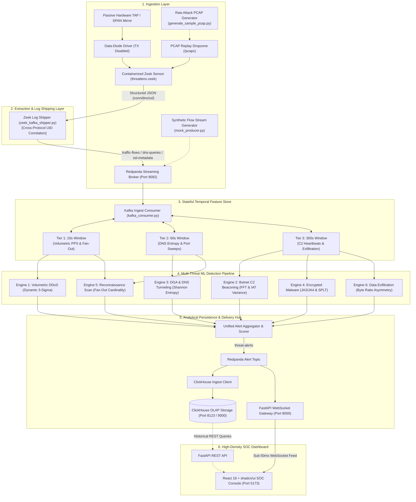

# ThreatLens: Real-Time Passive Network Threat Detection & Live Forensic Intelligence

[](https://www.python.org/)
[](https://fastapi.tiangolo.com/)
[](https://react.dev/)
[](https://www.typescriptlang.org/)
[](https://tailwindcss.com/)
[](https://ui.shadcn.com/)
[](https://redis.io/)
[](https://clickhouse.com/)
[](https://redpanda.com/)
[](https://zeek.org/)
[](https://www.docker.com/)
[](https://notraka-threatlens.hf.space)
[](LICENSE)

> 🛡️ **Live Deployment**: [https://notraka-threatlens.hf.space](https://notraka-threatlens.hf.space)  
> 📦 **Hugging Face Space**: [https://huggingface.co/spaces/NotRaka/ThreatLens](https://huggingface.co/spaces/NotRaka/ThreatLens)

ThreatLens is an enterprise-grade, read-only passive network threat detection and forensic intelligence platform. Designed for high-throughput packet metadata inspection, sliding-window anomaly detection, and dense Security Operations Center (SOC) visualization, ThreatLens enables line-rate visibility into hostile enterprise network flows without decrypting payloads or causing inline backpressure.

---

## 1. System Architecture Overview

ThreatLens implements a decoupled, event-driven streaming architecture across six functional pipeline layers:



---

## 2. Core Architectural Pillars

### A. Zero-Transmit Passive Ingestion & Containerized Zeek Sensor
To eliminate the risk of operational disruption, transmission leakage, or discovery by adversaries, the sensor platform enforces strict data-diode ingestion:
- **Data-Diode Operating Mode**: Physical and virtual monitor interfaces run in unaddressed promiscuous mode with all Layer 2 and Layer 3 outbound transmissions disabled (`ip link set <dev> arp off; sysctl -w net.ipv6.conf.<dev>.disable_ipv6=1`). ARP, ICMP, DHCP, and IPv6 router solicitations are blocked at the kernel level.
- **Containerized Zeek Sensor**: A hardened Zeek 6+ container (`threatlens-zeek`) equipped with `tcpreplay` and `inotify-tools` processes network flows in one of three modes:
  - `watch` (Default): Continuously monitors `/pcaps` via `inotifywait` to dynamically ingest and parse new `.pcap` and `.pcapng` capture files as they land.
  - `replay`: Batch processes all existing captures in `/pcaps` deterministically for historical forensics.
  - `live`: Directly attaches to hardware TAP / SPAN interfaces for line-rate passive packet inspection.
- **Optimized Zeek Policy (`local.zeek`)**: Configured for line-rate JSON streaming with ISO8601 timestamps (`JSON::TS_ISO8601`), silent disabling of noisy telemetry (`PacketFilter`, `Weird`, `Notice`, `Files`, `Software`, `Reporter`), and dynamic extraction of TLS JA3/JA4 cryptographic fingerprints.
- **Cross-Protocol Session Correlation (`zeek_kafka_shipper.py`)**: Asynchronously tails `conn.log`, `dns.log`, and `ssl.log`. By tracking shared Zeek session UIDs, the shipper correlates cryptographic TLS JA3 hashes and DNS query names directly to parent connection 5-tuples and decodes TCP history flags (`S` = SYN, `h` = SYN+ACK, `A` = ACK, `D` = PSH, `F` = FIN, `R` = RST) before streaming to Redpanda.
- **Resilient Pipeline Pre-flights**: Fast socket pre-flight checks for ClickHouse and KafkaProducer ensure the ingestion pipeline and Zeek log shippers fail fast and recover gracefully during broker or DB unavailability without hanging.
- **Pluggable Ingestion Runtime Switch**: The backend supports zero-downtime switching between `INGEST_SOURCE=synthetic` (internal generator) and `INGEST_SOURCE=kafka` (live Zeek / PCAP streaming) via environment configuration.

### B. Stateful Temporal Memory
Adversaries intentionally bypass static signature firewalls by staging attacks across multi-minute windows. ThreatLens deploys three synchronized sliding windows implemented using Redis sorted sets (`ZADD`, `ZRANGEBYSCORE`, `ZREMRANGEBYSCORE`) with bounded in-memory fallbacks:
- **10-Second Window**: Evaluates high-frequency volumetric spikes, SYN flood concentrations, and immediate destination endpoint fan-out sweeps.
- **60-Second Window**: Tracks domain lexical distributions, DNS resolution bursts, and horizontal port scanning spreads.
- **300-Second Window**: Captures persistent C2 beaconing heartbeats, inter-arrival time distributions, and sustained outbound data exfiltration ratios.
- **Automated Memory Bounds**: Timestamps older than the active horizon are evicted during every write cycle with an automatic TTL safeguard, preventing memory exhaustion.

### C. Non-Decrypted Cryptographic Profiling
ThreatLens enforces zero packet payload decryption, preserving network privacy and cryptographic integrity:
- **Cryptographic Fingerprinting**: Extracts client JA3 and JA4 hashes derived from TLS ClientHello parameters (ciphers, extensions, supported groups, and point formats).
- **Sequence of Packet Lengths and Times (SPLT)**: Captures directional byte lengths and millisecond-precision packet intervals during connection negotiation to classify malicious tools without inspecting payload bytes.

### D. Modernized High-Density SOC Dashboard & Telemetry Visualizations
Built with React 18, Vite, Tailwind CSS, Recharts, and Framer Motion, the ThreatLens UI delivers line-rate observability into streaming network telemetry:
- **Real-Time Sliding Stream Waveforms (`ThreatTrends`)**: Ticks every 1 second to advance the timeline continuously across customizable horizons (`LIVE 1M`, `LAST 5M` [default], `LAST 15M`, `LAST 1H`, `LAST 6H`). Slices threats into dynamic rate frequencies across all 6 threat vectors with smooth monotone interpolation and persistent session caching.
- **Interactive Full-Width Throughput Telemetry (`ThroughputGauge`)**: Spans 100% of the monitor grid, replacing redundant telemetry cards. Features 3 interactive metric cards (Flows Ingress, Packet Velocity, Wire Bandwidth) that serve as 1-click chart switchers with active glow borders and indicators. Includes full-fidelity X/Y axes, units, Cartesian grid lines, and diode status badges (`ZERO-EGRESS READ-ONLY`, `RETURN PATH: NONE`).
- **Centered Dark Fiber Enclave Authentication Portal (`LoginPage`)**: Features a centered organic fiber-optic neural network topology visual (`object-cover object-center`), radial dark vignette into `#09090b`, live promiscuous TAP stream console, and technical enclave specification cards. Bundled in pure text (Base64 WebP) to eliminate Git LFS / binary push restrictions on Hugging Face Spaces.
- **Hierarchical Incident Clusters & Deep PCAP Forensics**: Aggregates multi-vector alerts into interactive incident groups with collapsible accordions, one-click lifecycle triage (`NEW` → `INVESTIGATING` → `RESOLVED`), and slide-over forensic dossiers with hex/ASCII payload previews and analyst notes.

---

## 3. Standardized Alert Contract

All detection modules, stream topics, database tables, and WebSocket payloads adhere to a synchronized contract enforced by Pydantic v2 (`backend/app/schemas.py`) and TypeScript interfaces (`frontend/src/types/threat.ts`):

```json
{
  "timestamp": "2026-09-13T01:00:00.000Z",
  "flow_id": "192.168.1.105:54321->198.51.100.44:8443",
  "threat_class": "Botnet C2 Beaconing",
  "confidence_score": 0.94,
  "evidence": {
    "inter_arrival_variance": 0.0012,
    "shannon_entropy": 3.82,
    "byte_ratio": 0.08,
    "fan_out_count": 1,
    "ja3_hash": "e7d705a3286e19ea42f587b344ee6865",
    "details": "Periodic beaconing detected at 15.0s intervals via FFT harmonic analysis."
  }
}
```

### Contract Properties

| Property | Type | Specification |
| :--- | :--- | :--- |
| `timestamp` | `datetime` (ISO 8601 UTC) | Exact UTC timestamp of threat evaluation. |
| `flow_id` | `string` | Canonical flow identifier in format: `src_ip:src_port->dst_ip:dst_port`. |
| `threat_class` | `ThreatClassEnum` | Standardized categorization across the 6 supported threat vectors. |
| `confidence_score` | `float` ($0.00 \le c \le 1.00$) | Probability and heuristic confidence index. |
| `evidence.inter_arrival_variance` | `float` | Population variance of packet inter-arrival times ($\Delta t$) in seconds squared. |
| `evidence.shannon_entropy` | `float` | Character-level Shannon entropy in bits ($0.0 \le H \le 8.0$). |
| `evidence.byte_ratio` | `float` | Outbound egress bytes divided by inbound ingress bytes. |
| `evidence.fan_out_count` | `integer` | Count of unique external IP addresses or ports contacted in the window. |
| `evidence.ja3_hash` | `string` (Nullable) | 32-character MD5 cryptographic hash of TLS ClientHello parameters. |
| `evidence.details` | `string` | Human-readable forensic summary and heuristic rationale. |

### Streaming Broker Topic Specifications

| Topic Name | Producer Source | Serialization | Payload Contents |
| :--- | :--- | :--- | :--- |
| `traffic-flows` | `ZeekLogShipper` / `SyntheticFlowGenerator` | JSON | Normalized 5-tuple flow records, byte/packet counts, duration, protocol, TCP history flags, and correlated JA3/DNS tokens. |
| `dns-queries` | `ZeekLogShipper` (`dns.log`) | JSON | DNS query domain (FQDN), record query type (A, AAAA, TXT), response code, and session correlation `uid`. |
| `ssl-metadata` | `ZeekLogShipper` (`ssl.log`) | JSON | TLS handshake parameters, SNI server name, cipher suite, JA3/JA4 cryptographic fingerprints, and correlation `uid`. |
| `threat-alerts` | `DetectionPipeline` (`AlertAggregator`) | JSON | Unified forensic threat alerts conforming to `ThreatAlertSchema` for ClickHouse indexing and WebSocket broadcast. |

---

## 4. Detection Engines Matrix

| Threat Class | Detection Methodology | Mathematical Formulation | Window Tier | Operational Trigger |
| :--- | :--- | :--- | :--- | :--- |
| **Volumetric & Protocol DDoS** | Statistical 3-Sigma Surge & SYN/UDP Ratio | $Z = \frac{\text{PPS} - \mu}{\sigma} > 3.0$ | 10 Seconds | $\text{PPS} > 1,000$, $\text{SYN Ratio} > 0.85$, or UDP storm exceeding 3.0 standard deviations. |
| **Botnet C2 Beaconing** | Fast Fourier Transform (FFT) & Low IAT Variance | $\text{Var}(\Delta t) = \frac{1}{N} \sum (\Delta t - \mu)^2$ | 300 Seconds | Automated recurring connections ($\ge 4$ events) with interval variance $\text{Var}(\Delta t) < 0.05\text{ s}^2$. |
| **DGA & DNS Tunneling** | Character Shannon Entropy & FQDN Length Analysis | $H(X) = -\sum P(x) \log_2 P(x)$ | 60 Seconds | Domain query $H(X) \ge 3.80\text{ bits}$, query length $> 60\text{ chars}$, or TXT tunneling. |
| **Encrypted Malware** | Threat Intelligence JA3 Matching & SPLT Profiling | $\text{Score}(\mathbf{x}) = 2^{-\frac{E(h(\mathbf{x}))}{c(n)}}$ | 300 Seconds | Known malicious JA3 hash match (TrickBot, Cobalt Strike, Emotet) or SPLT burst outlier. |
| **Reconnaissance Scan** | Endpoint Cardinality Dispersion & SYN Asymmetry | $C = \vert \mathcal{D} \vert = \text{Card}(\text{Targets})$ | 10s / 60s | Single source IP probing $\ge 15$ distinct ports or external IP addresses with $\le 2$ packets per target. |
| **Data Exfiltration** | Outbound Flow Ratio & High-Volume Egress Z-Score | $R = \frac{\text{Bytes(Egress)}}{\max(\text{Bytes(Ingress)}, 1)}$ | 300 Seconds | Non-server host transmitting $> 5\text{ MB}$ outbound with flow asymmetry ratio $R \ge 50.0$. |

---

## 5. Repository Structure

```
ThreatLens/
├── backend/
│   ├── app/
│   │   ├── __init__.py
│   │   ├── main.py                 # FastAPI application, REST endpoints, WebSocket hub & background stream worker
│   │   ├── schemas.py              # Pydantic v2 schemas: ThreatClassEnum, EvidenceSchema, ThreatAlertSchema
│   │   ├── storage.py              # ClickHouseAlertStore: table initialization, batch insert & memory ring buffer
│   │   └── websocket_manager.py    # ConnectionManager: live client connection tracking & sub-50ms alert broadcast
│   ├── requirements.txt            # Backend dependencies (FastAPI, Redis, ClickHouse, Pydantic, Scikit-learn, httpx)
│   └── tests/
│       ├── __init__.py
│       ├── test_api.py             # FastAPI REST & WebSocket endpoint integration tests (TestClient)
│       ├── test_engines.py         # Multi-model detection engines and pipeline integration tests
│       ├── test_features.py        # Statistical metrics, Shannon entropy, and SlidingWindowStore tests
│       ├── test_pcap_replay.py     # Zeek JSON normalization, UID correlation & PCAP replay attack validation
│       ├── test_runtime_config.py  # Runtime threshold/suppression config: validation, persistence & suppression integration
│       └── test_suppression.py     # Allowlist & suppression rule mechanics through RuntimeConfigStore and the pipeline
├── engine/
│   ├── __init__.py
│   ├── config.py                   # Authoritative detector threshold values, specs & live-read accessors
│   ├── kafka_consumer.py           # KafkaIngestConsumer: Redpanda telemetry subscriber & pipeline dispatcher
│   ├── pipeline.py                 # DetectionPipeline orchestrator & process_flow_event callable entrypoint
│   ├── runtime_config.py           # RuntimeConfigStore: Redis-mirrored threshold overrides & analyst suppression rules
│   ├── features/
│   │   ├── __init__.py
│   │   ├── metrics.py              # Shannon entropy, flow ratio, IAT variance, and fan-out calculators
│   │   └── store.py                # SlidingWindowStore: Redis sorted sets (10s, 60s, 300s) with in-memory deque fallback
│   └── models/
│       ├── __init__.py
│       ├── aggregator.py           # AlertAggregator: concurrent multi-model dispatch & confidence score normalizer
│       ├── base.py                 # BaseDetectionEngine interface & DetectionCandidate dataclass
│       ├── beaconing_engine.py     # Botnet C2 beaconing engine (FFT harmonic periodicity & low IAT variance)
│       ├── ddos_engine.py          # Volumetric DDoS engine (Dynamic 3-sigma PPS & SYN flood evaluation)
│       ├── dns_engine.py           # DGA & DNS tunneling engine (Character Shannon entropy & payload size thresholds)
│       ├── exfiltration_engine.py  # Data exfiltration engine (Outbound-to-inbound byte asymmetry Z-scores)
│       ├── malware_engine.py       # Encrypted malware engine (JA3 cryptographic fingerprint matching & SPLT heuristics)
│       └── recon_engine.py         # Reconnaissance scan engine (Multi-tier endpoint cardinality dispersion)
├── frontend/
│   ├── index.html                  # HTML5 template with dark theme and Inter/JetBrains Mono fonts
│   ├── package.json                # React 18, Vite, Tailwind CSS, Recharts, Framer Motion, Hugeicons
│   ├── postcss.config.js           # PostCSS Tailwind CSS pipeline
│   ├── tailwind.config.js          # Tailwind CSS theme tokens & dark color configurations
│   ├── tsconfig.json               # TypeScript compiler options & '@/*' path alias
│   ├── tsconfig.node.json          # Vite node configuration
│   ├── vite.config.ts              # Vite dev server with proxy routing for /api and /ws
│   └── src/
│       ├── App.tsx                 # Main SOC Enclave layout with KPI cards, expanded throughput & threat stream
│       ├── index.css               # Global styles, dark WCAG AA tokens, and customized SOC scrollbars
│       ├── main.tsx                # React DOM root entrypoint
│       ├── assets/
│       │   └── heroImage.ts        # Base64 WebP encoded dark fiber neural network visual (plain-text bundled)
│       ├── components/
│       │   ├── AnimatedNumber.tsx  # Spring-interpolated tabular numeric transitions
│       │   ├── DashboardSkeleton.tsx# Synchronized loading skeletons matching exact widget dimensions
│       │   ├── DetectionConfig.tsx # Slide-over rule management: runtime thresholds & suppression rule CRUD
│       │   ├── ForensicDrawer.tsx  # Deep forensic dossier: SPLT metrics, JA3 copy, timeline & analyst notes
│       │   ├── IncidentsPanel.tsx  # Collapsible incident groups with one-click lifecycle triage
│       │   ├── LoginPage.tsx       # Centered fiber visual, enclave specs, RBAC quick-fill & live TAP console
│       │   ├── Navbar.tsx          # Brand header: live stream pulse pill, real-time UTC clock & user badge
│       │   ├── ThreatTable.tsx     # High-density alert stream: severity badges, inline triage & search filters
│       │   ├── ThreatTrends.tsx    # 1-second sliding-window waveform across all 6 threat vectors
│       │   ├── ThroughputGauge.tsx # Full-width multi-metric stream area chart with interactive tab switchers
│       │   └── ui/                 # Reusable shadcn/ui primitives (badge, button, card, sheet, table, tabs, tooltip)
│       ├── hooks/
│       │   └── useThreatSocket.ts  # Resilient auto-reconnecting WebSocket hook with rolling buffer & pause toggle
│       ├── lib/
│       │   ├── motion.ts           # Framer Motion tokens, spring physics & prefers-reduced-motion hook
│       │   ├── threatMapping.ts    # Short threat names and color mapping helpers
│       │   └── utils.ts            # Class merging utility (clsx + tailwind-merge) and formatting helpers
│       └── types/
│           └── threat.ts           # Synchronized TypeScript interfaces matching backend Pydantic schemas
├── ingest/
│   ├── __init__.py
│   ├── producers/
│   │   ├── __init__.py
│   │   ├── mock_producer.py        # Synthetic multi-class network flow stream generator and Kafka publisher
│   │   └── zeek_kafka_shipper.py   # ZeekLogShipper: tails JSON logs, normalizes flows & ships to Redpanda
│   └── zeek/
│       ├── Dockerfile              # Hardened Zeek container image with tcpreplay and inotify-tools
│       ├── entrypoint.sh           # Ingestion daemon entrypoint (watch, replay, and live TAP modes)
│       ├── generate_sample_pcap.py # Pure-Python raw attack PCAP generator (benign, SYN flood, C2, DGA)
│       └── local.zeek              # Zeek policy: JSON logging, ISO8601 timestamps, JA3/JA4 extraction
├── pcaps/                          # Monitored dropzone directory for automated PCAP replay ingestion
├── docker-compose.yml              # Multi-service hybrid pipeline (Redpanda, Redpanda Console, Redis, ClickHouse, Zeek)
├── .env.example                    # Service ports, hostnames, and detection parameters
└── .gitignore                      # Environment secrets, logs, PCAPs, and build artifact exclusions
```

---

## 6. Local Quickstart Guide

### System Prerequisites
- **Python**: Version 3.11 or higher
- **Node.js**: Version 18 or higher (with `npm`)
- **Docker**: Docker Engine and Docker Compose v2+

---

### Step 1: Clone Repository & Configure Environment
```bash
git clone https://github.com/RaKa8904/ThreatLens.git
cd ThreatLens
cp .env.example .env
```

---

### Step 2: Bootstrap Infrastructure Services (Docker)
Start the streaming broker, in-memory sliding-window store, analytical OLAP archive, and containerized Zeek sensor:
```bash
docker compose up -d
```

Service access points:
- **Redpanda Broker**: `localhost:9092`
- **Redpanda Web Console**: [http://localhost:8080](http://localhost:8080)
- **Redis Feature Store**: `localhost:6379`
- **ClickHouse HTTP Interface**: [http://localhost:8123/ping](http://localhost:8123/ping)
- **Zeek Sensor Daemon**: `threatlens-zeek` (monitoring `/pcaps` dropzone and writing structured JSON logs to `/logs`)

---

### Step 3: Set Up Backend & Launch FastAPI Gateway
Initialize the Python virtual environment and install backend dependencies:
```bash
# Initialize virtual environment
python -m venv .venv

# Activate environment:
# On Linux / macOS:
source .venv/bin/activate
# On Windows PowerShell:
.\.venv\Scripts\Activate.ps1

# Install backend dependencies
pip install -r backend/requirements.txt
```

ThreatLens supports two pluggable ingestion runtime modes configured via `.env`:

#### Mode A: Real-Time Synthetic Stream (Default)
Generates a healthy enterprise telemetry baseline mixed with controlled periodic PCAP attack injections, simulating all 6 threat vectors in a balanced round-robin cycle at a tuned stream rate of 3-4 flows/sec with dynamic jitter:
```bash
# Set in .env: INGEST_SOURCE=synthetic
# Normal startup: use ThreatLens.bat (no --reload; the reloader's watcher
# crashes on data\clickhouse with WinError 1920). For iterative development:
uvicorn backend.app.main:app --port 8000 --reload --reload-dir backend --reload-dir engine --reload-dir ingest
```

#### Mode B: Live PCAP Replay & Zeek Ingestion Pipeline
Processes real packet captures or hardware TAP feeds via the containerized Zeek sensor:
```bash
# 1. Generate all 6 sample threat vector PCAPs with pure Python generator (or drop any .pcap into pcaps/):
python ingest/zeek/generate_sample_pcap.py --output pcaps/sample_attack.pcap

# The running 'threatlens-zeek' container automatically detects the file via inotify,
# applies local.zeek policies, extracts JA3 hashes, and writes JSON logs to logs/

# 2. Ship normalized Zeek logs to Redpanda topics (traffic-flows, dns-queries, ssl-metadata):
# PCAP replay alerts are fully wired into the global pipeline to directly populate the SOC dashboard.
python ingest/producers/zeek_kafka_shipper.py --mode batch

# 3. Start FastAPI with Kafka consumer enabled:
# Set in .env: INGEST_SOURCE=kafka
uvicorn backend.app.main:app --port 8000 --reload --reload-dir backend --reload-dir engine --reload-dir ingest
```

FastAPI endpoints:
- **Interactive OpenAPI Documentation**: [http://localhost:8000/docs](http://localhost:8000/docs)
- **Healthcheck Endpoint**: [http://localhost:8000/api/health](http://localhost:8000/api/health)
- **Historical Alerts Endpoint**: [http://localhost:8000/api/alerts](http://localhost:8000/api/alerts)
- **Real-Time Throughput Metrics**: [http://localhost:8000/api/metrics/throughput](http://localhost:8000/api/metrics/throughput)
- **WebSocket Broadcast Stream**: `ws://localhost:8000/ws/threats`

---

### Step 4: Set Up Frontend & Launch SOC Enclave Dashboard
Open a secondary terminal to launch the React 18 dashboard:
```bash
cd frontend
npm install
npm run dev
```

Open the dashboard in your browser: [http://localhost:5173](http://localhost:5173)

---

### Step 5: Execute Complete Test Suite
Run all 141 statistical, detection engine, pipeline, PCAP replay, authentication security, and storage resilience tests:
```bash
pytest backend/tests -v
```

Expected output:
```text
============================= test session starts =============================
platform win32 -- Python 3.11+ / 3.13+, pytest, pluggy
rootdir: ThreatLens
plugins: anyio
collected 141 items

backend/tests/test_alert_identity.py::TestAlertIdentity ........................ [  4%]
backend/tests/test_api.py::TestFastAPIGateway .................................. [ 10%]
backend/tests/test_auth_security.py ............................................ [ 15%]
backend/tests/test_engines.py::TestThreatDetectionEngines ...................... [ 25%]
backend/tests/test_engines.py::TestPipelineAndAggregator ....................... [ 30%]
backend/tests/test_env_loading.py .............................................. [ 35%]
backend/tests/test_features.py::TestStatisticalMetrics ......................... [ 45%]
backend/tests/test_features.py::TestSlidingWindowStore ......................... [ 55%]
backend/tests/test_features.py::TestSyntheticFlowGenerator ..................... [ 65%]
backend/tests/test_pcap_replay.py::TestZeekLogNormalization .................... [ 75%]
backend/tests/test_pcap_replay.py::TestPCAPReplayAttacks ....................... [ 85%]
backend/tests/test_replay_api.py::TestReplayAPI ................................ [ 90%]
backend/tests/test_runtime_config.py ........................................... [ 92%]
backend/tests/test_severity.py ................................................. [ 95%]
backend/tests/test_storage_resilience.py ....................................... [ 98%]
backend/tests/test_suppression.py .............................................. [100%]

======================= 141 passed in ~2.8s =======================
```

---

## 7. Roadmap & Milestone Status

| Milestone | Phase | Scope & Deliverables | Status |
| :---: | :--- | :--- | :--- |
| **01** | Core Contracts & Docker Stack | Pydantic v2 schemas, synchronized TypeScript types, and multi-service `docker-compose.yml`. | Complete |
| **02** | Feature Store & Synthetic Stream | SlidingWindowStore (10s, 60s, 300s), Shannon entropy, IAT variance, and synthetic generator. | Complete |
| **03** | Multi-Threat ML Detection Pipeline | 6 specialized detection engines, FFT periodicity, dynamic 3-sigma scoring, and AlertAggregator. | Complete |
| **04** | Streaming Gateway & Persistence | ClickHouse columnar storage client, FastAPI REST API, and sub-50ms WebSocket broadcast hub. | Complete |
| **05** | Modern High-Density SOC Dashboard | React 18 dashboard with Framer Motion, real-time sliding-window ThreatTrends waveform, expanded full-width interactive ThroughputGauge, centered dark fiber LoginPage, ForensicDrawer, and PCAP replay modal. | Complete |
| **06** | Hardware TAP & Live PCAP Replay | Containerized Zeek sensor (watch/replay/live), local.zeek JSON/JA3 policy, asynchronous ZeekLogShipper, KafkaIngestConsumer, sample PCAP generator, and 15 validation tests. | Complete |
| **07** | Live Alert Suppression & Rule Tuning | Analyst-configurable runtime thresholds (22 parameters, 7 rules), suppression/allowlist rules with CIDR + expiry + enable/disable, Redis-mirrored persistence with honest memory-mode reporting, and the Detection Configuration dashboard panel. | Complete |

> [!NOTE]
> All seven core architecture milestones are complete, verified with 141 passing end-to-end tests and active containerized components. Runtime configuration is analyst-tunable (not adaptive ML); changes apply to new detections immediately without a restart. Future roadmap items include kernel-bypass eBPF/XDP hardware filtering and automated BGP FlowSpec mitigation triggers.

---

## License

This project is licensed under the Apache License 2.0. See the [LICENSE](LICENSE) file for details.
